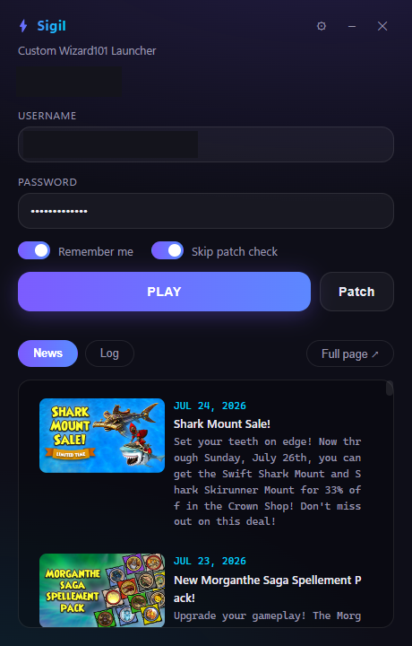
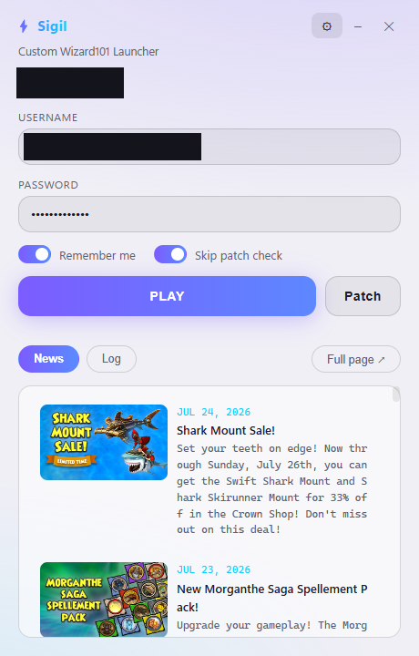
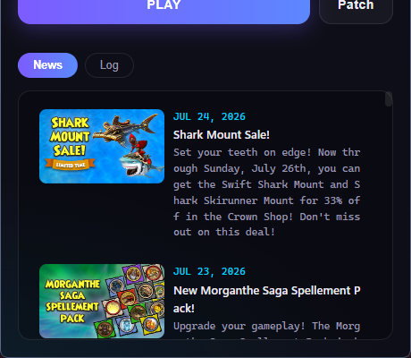
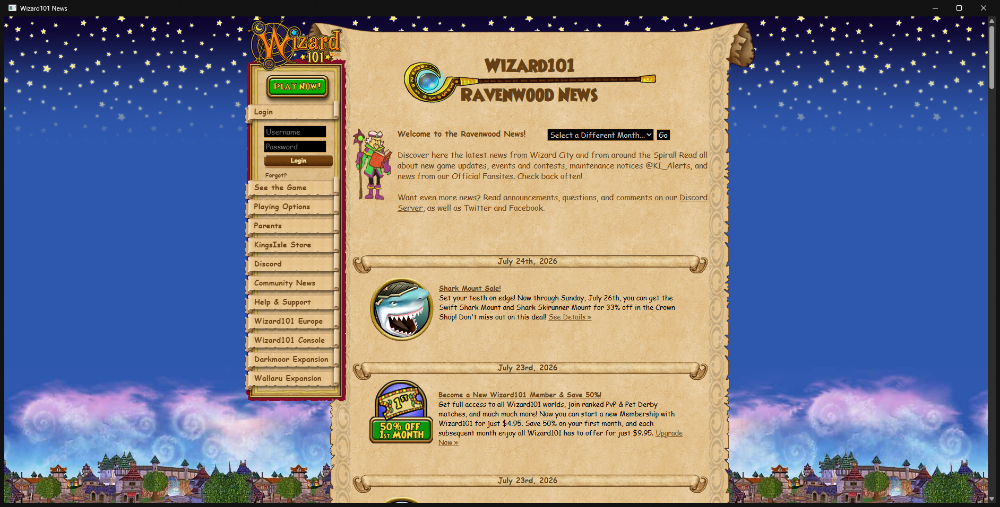
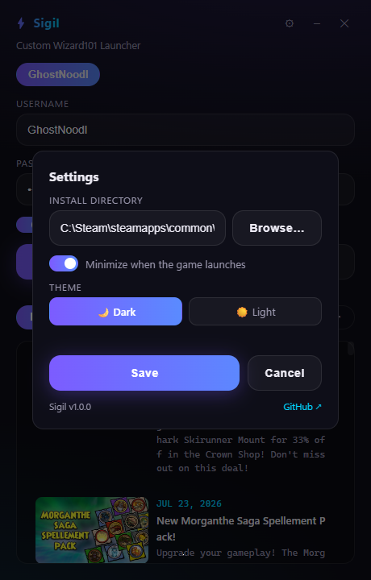

# Sigil


A fast, modern, open-source custom launcher for **Wizard101** (US servers).
Step into the Sigil and go straight to character select.
Skip the official launcher's slow file validation and go from double-click
to character select in seconds.



<sub>Dark theme</sub>



<sub>Light theme</sub>

## Features

- **Instant launch** — authenticates directly with KingsIsle's login server
  and starts the game with a session token. No patcher UI, no login screen.
- **Fast incremental patching** — verifies only what's installed against the
  official patch manifest (CRC-checked, concurrent, atomic downloads).
  A full check of a complete install takes seconds, not minutes.
- **Live news feed** — recent Wizard101 news right in the launcher, pulled
  from the same API as the official website, with one click to open the
  full official news page in a built-in browser window.




- **Steam support** — works with Steam installs (authenticates with
  `IsSteamPatcher` + Steam ticket, exactly like the official flow) as well
  as standalone installs.
- **Secure credentials** — passwords are stored in Windows Credential
  Manager, never on disk. Multi-account support with one-click switching
  (multi-boxing is tolerated by KingsIsle).
- **Modern UI** — frameless dark window with gradient accents, built with
  Wails (WebView2). Full CLI included for scripting.

## Quick start

1. Download `sigil.exe` from
   [Releases](https://github.com/GhostNoodl/sigil-w101launcher/releases) — it's a
   single self-contained file (icon, manifest, and frontend all embedded).
2. Double-click it.
3. Enter your Wizard101 username and password, leave **Remember me** on,
   hit **PLAY**. Credentials are saved to Credential Manager — next time,
   just pick your account and click PLAY.

Notes:

- The install location is auto-detected; change it anytime under
  **⚙ Settings** (install dir, light/dark theme, and an option to
  minimize the launcher when the game starts).


- **Steam users:** Steam must be running when you launch.
- Tick **Skip patch check** for the fastest start; leave it unticked after
  game updates so files get verified first (still only seconds). Toggle
  states are remembered between launches.
- **Windows SmartScreen** may warn on first run because the exe is not
  code-signed — click "More info" → "Run anyway". This is expected for
  unsigned open-source builds; you can also build from source below.

## CLI

The same binary works from a terminal (use the console build
`sigil-debug.exe` for visible output):

```
sigil play [username] [--no-patch] [--full]
sigil patch [--full]
sigil accounts add|remove|list
sigil config show | set-dir <path>
```

Config lives at `%APPDATA%\w101client\config.json`.

## FAQ

**Is this against the rules?**
The `-L` quick-launch flag is a first-party feature of the game client, and
multi-boxing is explicitly tolerated by KingsIsle. That said, any
third-party tool is used at your own risk.

**Which versions are supported?**
US live realm, both the standalone and Steam installs. EU servers are
Gameforge-hosted and use a different flow (not supported).

**The game updated — what do I do?**
Just launch without "Skip patch check" once. The launcher downloads the
update from the official patch servers in seconds.

**Where does my password go?**
Nowhere unusual. It's stored in Windows Credential Manager and used only
for the official login-server handshake (CK1/CK2 challenge — the same
scheme the official launcher uses; the plaintext password never leaves
your machine).

## Building from source

Requires Go 1.24+. No cgo, no Node toolchain — the Wails frontend is plain
HTML/CSS/JS embedded in the binary.

```sh
go build -tags "desktop production" -ldflags "-H windowsgui" -o sigil.exe .
go build -tags "desktop production" -o sigil-debug.exe .   # console build
```

The `desktop production` tags are required by Wails (the `wails` CLI adds
them automatically; plain `go build` needs them spelled out).

Icon, manifest, and version info are embedded via
[go-winres](https://github.com/tc-hib/go-winres). To regenerate after
changing `winres/winres.json` or the icon:

```sh
go run ./tools/icongen                        # redraw docs/icon-256.png
go run github.com/tc-hib/go-winres@latest make  # writes rsrc_*.syso
```

## How it works

The official launcher (`Wizard101.exe`) is just a patcher plus a login
form. The actual game, `Bin\WizardGraphicalClient.exe`, natively accepts:

```
WizardGraphicalClient.exe -L <login host> <port> -A <locale> [-ST -P 0 -PT 0] -U ..<userID> <ck2> <username>
```

W101 Client reproduces the launcher's side of that handshake
(`UserAuthenV3`, including the `IsSteamPatcher` flag Steam-linked accounts
require), fetches a fresh session token, and hands it to the client.
Patching talks to the official patch server and CDN; news comes from
KingsIsle's public GraphQL API.

Protocol implementation builds on the community-documented KINP protocol
via [cedws/w101-client-go](https://github.com/cedws/w101-client-go) and
[cedws/w101-proto-go](https://github.com/cedws/w101-proto-go), with thanks
to [umbra-launcher](https://github.com/cedws/umbra-launcher) and the
[On-Wiz](https://github.com/latelylk/On-Wiz) research project.

## Disclaimer

Sigil is an unofficial, fan-made project. It is **not affiliated with,
endorsed by, sponsored by, or connected to** KingsIsle Entertainment, Inc.,
gamigo group, or any of their partners or subsidiaries.

Wizard101, KingsIsle, and all related names, marks, and assets are
trademarks or registered trademarks of their respective owners. This
project is provided "as is", without warranty of any kind; use it at your
own risk. The author is not responsible for any action taken against your
game account.

## License

[MIT](LICENSE)
